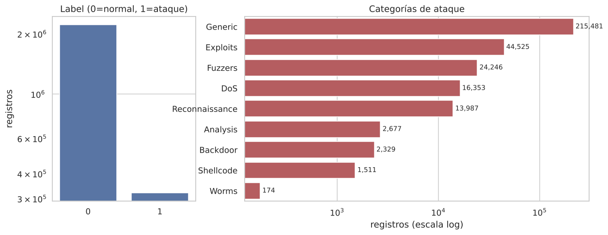
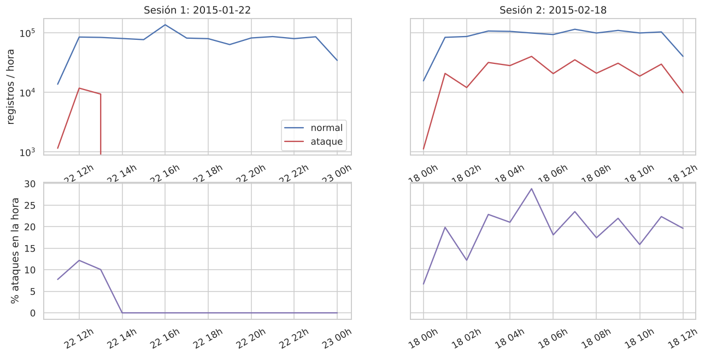
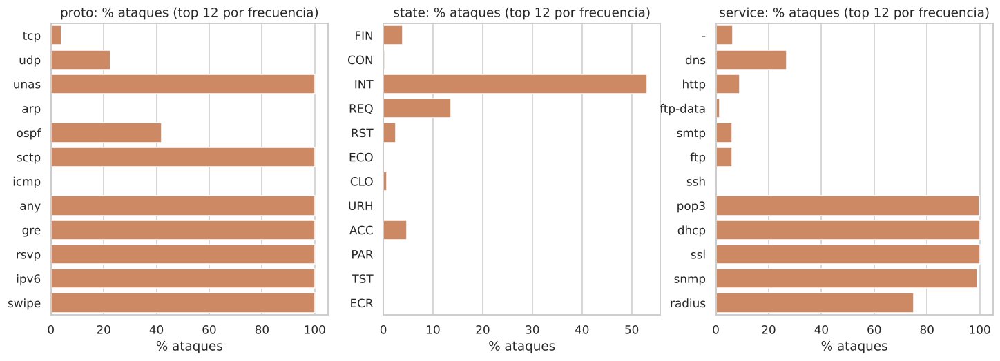
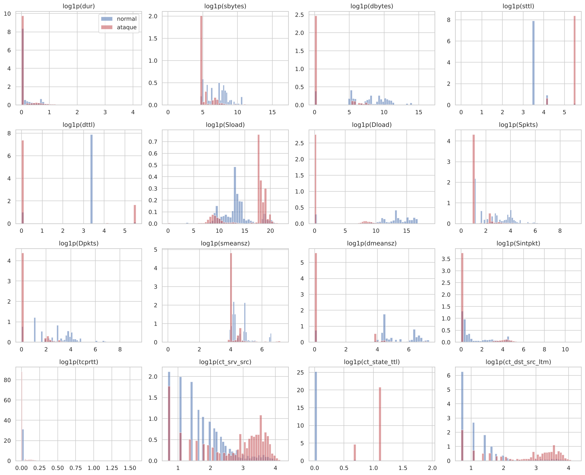
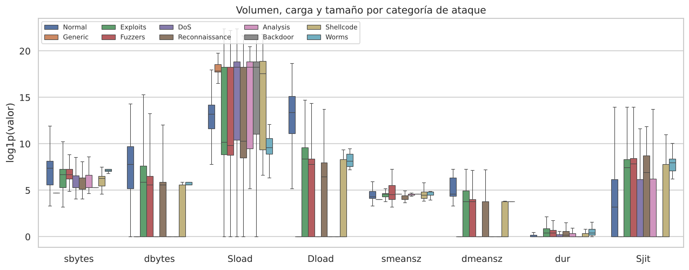
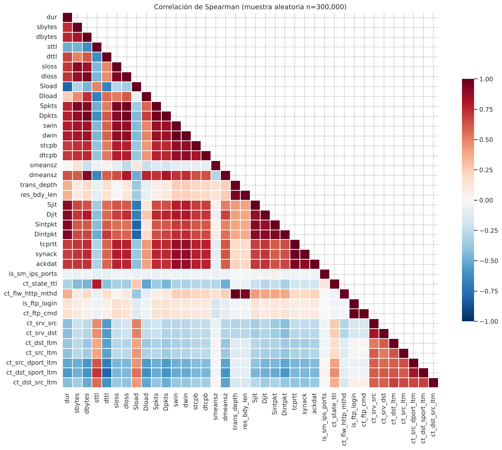
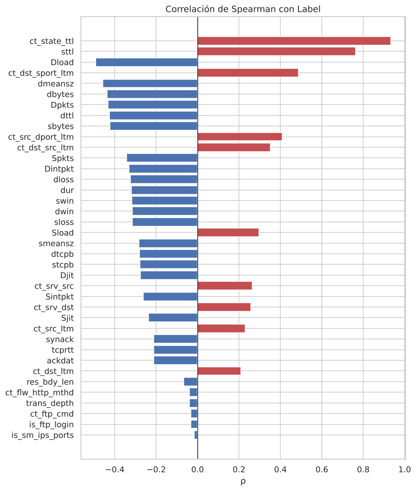

# EDA de los datos crudos UNSW-NB15

Reporte generado por `src/eda/raw_eda.py` sobre `data/raw/UNSW-NB15_{1..4}.csv`
(versión DVC `data/raw.dvc`). Reproducir con:

```bash
python -m src.eda.raw_eda          # escribe reports/eda_raw/{README.md,figures/,tables/}
```

Todas las cifras de este documento se calculan en el script; las tablas completas están en
`tables/` como CSV.

## 1. Carga y esquema

Los cuatro CSV crudos no tienen encabezado; los nombres de columna se toman de `NUSW-NB15_features.csv`. En total: **2,540,047 registros × 49 columnas** (memoria ≈ 1.2 GB en pandas).

*Registros, ataques y rango temporal (UTC) por archivo* (`tables/registros_por_archivo.csv`)

| file | registros | ataques | inicio | fin | pct_ataque |
|---|---|---|---|---|---|
| UNSW-NB15_1.csv | 700,001 | 22,215 | 2015-01-22 11:49 | 2015-01-22 19:44 | 3.174 |
| UNSW-NB15_2.csv | 700,001 | 52,749 | 2015-01-22 19:43 | 2015-02-18 03:45 | 7.536 |
| UNSW-NB15_3.csv | 700,001 | 157,425 | 2015-02-18 03:44 | 2015-02-18 09:00 | 22.49 |
| UNSW-NB15_4.csv | 440,044 | 88,894 | 2015-02-18 08:59 | 2015-02-18 12:21 | 20.2 |

Tipos declarados: integer: 28, float: 10, nominal: 6, binary: 3, timestamp: 2. El diccionario completo está en `tables/diccionario_columnas.csv`.

## 2. Calidad de datos

Anomalías de formato detectadas en los crudos y tratamiento aplicado en este EDA:

| columna | anomalía | registros |
|---|---|---|
| sport | valor hexadecimal (0x...) | 6 |
| sport | valor '-' | 2 |
| dsport | valor hexadecimal (0x...) | 297 |
| dsport | valor '-' | 7 |
| ct_ftp_cmd | cadena en blanco ' ' | 1,429,879 |
| ct_flw_http_mthd | nulo | 1,348,145 |
| is_ftp_login | nulo | 1,429,879 |
| is_ftp_login | valor no binario (>1) | 186 |
| attack_cat | nulo (registros normales) | 2,218,764 |
| attack_cat | espacios alrededor del nombre | 37,762 |
| attack_cat | 'Backdoors' (vs 'Backdoor') | 534 |

Tratamiento: puertos hexadecimales convertidos a entero y `'-'` a nulo; `ct_ftp_cmd` en
blanco → nulo; `attack_cat` sin espacios, `Backdoors` → `Backdoor` y nulo → `Normal`.
`is_ftp_login` debería ser binaria pero tiene valores 2 y 4.

**Los nulos dependen de la sesión de captura, no del flujo.** En la sesión 1 las columnas
FTP/HTTP siempre están informadas (0 cuando no aplican); en la sesión 2 quedan vacías salvo
en flujos `ftp`/`http`. Es decir, nulo = "no aplica" = 0. **No** debe crearse un indicador
de nulo: identificaría la sesión 2, que tiene una tasa de ataques 10 veces mayor (fuga).

*Nulos por sesión de captura* (`tables/nulos_por_sesion.csv`)

| sesión | registros | nulos ct_ftp_cmd | nulos is_ftp_login | nulos ct_flw_http_mthd |
|---|---|---|---|---|
| 1 | 1,087,203 | 0 | 0 | 0 |
| 2 | 1,452,844 | 1,429,879 | 1,429,879 | 1,348,145 |

En la sesión 2, los valores informados de `ct_ftp_cmd` son de `service=ftp` en un 99.99 % y los de `ct_flw_http_mthd` de `service=http` en un 99.2 %.

Consistencia entre `Label` y `attack_cat`:

|  | Label=0 | Label=1 |
|---|---|---|
| attack_cat ≠ Normal | 0 | 321,283 |
| attack_cat = Normal | 2,218,764 | 0 |

**Duplicados.** 480,633 filas (18.9 %) son copias exactas
de otra fila (todas las columnas, incluidos IP, puertos y timestamps). Si se ignoran
identificadores y timestamps, 599,406 filas (23.6 %)
comparten vector de features con otra, y 453 de esos grupos tienen
**etiquetas contradictorias** (mismo vector, `Label` 0 y 1). La duplicación se concentra en
algunas categorías de ataque:

*Duplicados exactos por categoría* (`tables/duplicados_por_categoria.csv`)

| attack_cat | registros | duplicados | pct_dup |
|---|---|---|---|
| Normal | 2,218,764 | 258,993 | 11.7 |
| Generic | 215,481 | 190,103 | 88.2 |
| Exploits | 44,525 | 16,926 | 38.0 |
| Fuzzers | 24,246 | 2,451 | 10.1 |
| DoS | 16,353 | 10,688 | 65.4 |
| Reconnaissance | 13,987 | 630 | 4.5 |
| Analysis | 2,677 | 493 | 18.4 |
| Backdoor | 2,329 | 346 | 14.9 |
| Shellcode | 1,511 | 0 | 0.0 |
| Worms | 174 | 3 | 1.7 |

## 3. Variable objetivo

El problema binario está **muy desbalanceado**: solo el 12.65 % de los
registros son ataques (≈ 1 ataque por cada 7
normales). Esto contrasta con los splits oficiales (training-set ≈ 68 % de ataques), que
fueron submuestreados. Dentro de los ataques, `Generic` y `Exploits` suman el
81 %; `Worms` tiene apenas
174 registros.

| Label | registros | pct |
|---|---|---|
| 0 | 2,218,764 | 87.35 |
| 1 | 321,283 | 12.65 |

| attack_cat | registros | pct_total | pct_ataques |
|---|---|---|---|
| Normal | 2,218,764 | 87.351 |  |
| Generic | 215,481 | 8.483 | 67.069 |
| Exploits | 44,525 | 1.753 | 13.858 |
| Fuzzers | 24,246 | 0.955 | 7.547 |
| DoS | 16,353 | 0.644 | 5.090 |
| Reconnaissance | 13,987 | 0.551 | 4.353 |
| Analysis | 2,677 | 0.105 | 0.833 |
| Backdoor | 2,329 | 0.092 | 0.725 |
| Shellcode | 1,511 | 0.059 | 0.470 |
| Worms | 174 | 0.007 | 0.054 |



*Distribución de la etiqueta binaria y de las categorías de ataque (escala log)*

## 4. Comportamiento temporal

Los timestamps (`Stime`) van de 2015-01-22 11:49 a 2015-02-18 12:21
UTC, pero la captura **no es continua**: son 2 sesiones de simulación del IXIA
PerfectStorm separadas por 25 días. Los archivos están ordenados en el tiempo y
`UNSW-NB15_2.csv` contiene el final de la sesión 1 y el comienzo de la sesión 2.

*Sesiones de captura (corte en huecos > 6 h)* (`tables/sesiones.csv`)

| sesión | inicio | fin | registros | ataques | archivos | horas | pct_ataque |
|---|---|---|---|---|---|---|---|
| 1 | 2015-01-22 11:49 | 2015-01-23 00:25 | 1,087,203 | 22,215 | UNSW-NB15_1.csv, UNSW-NB15_2.csv | 12.60 | 2.04 |
| 2 | 2015-02-18 00:23 | 2015-02-18 12:21 | 1,452,844 | 299,068 | UNSW-NB15_2.csv, UNSW-NB15_3.csv, UNSW-NB15_4.csv | 11.96 | 20.59 |

**Cambio de prior entre sesiones**: la sesión 2 tiene un 20.6 % de
ataques frente al 2.0 % de la sesión 1. Además, en la sesión 1 los
ataques solo ocurren entre 11:50 y 13:47 UTC
(2.0 h de 12.6 h); el resto
de la sesión es tráfico normal. En la sesión 2 los ataques se reparten de forma continua
(figura). Todas las categorías de
ataque aparecen en ambas sesiones (tabla siguiente), así que un split por sesión es viable,
pero el umbral de decisión calibrado en una sesión no se transfiere directamente a la otra.

*Registros por categoría y sesión* (`tables/attack_cat_por_sesion.csv`)

| attack_cat | sesión 1 | sesión 2 |
|---|---|---|
| Normal | 1,064,988 | 1,153,776 |
| Generic | 7,522 | 207,959 |
| Exploits | 5,409 | 39,116 |
| Fuzzers | 5,051 | 19,195 |
| Reconnaissance | 1,759 | 12,228 |
| DoS | 1,167 | 15,186 |
| Backdoor | 534 | 1,795 |
| Analysis | 526 | 2,151 |
| Shellcode | 223 | 1,288 |
| Worms | 24 | 150 |



*Registros por hora por clase y proporción de ataques (UTC)*

*Composición (% de registros) de cada archivo por categoría* (`tables/attack_cat_por_archivo.csv`)

| attack_cat | UNSW-NB15_1.csv | UNSW-NB15_2.csv | UNSW-NB15_3.csv | UNSW-NB15_4.csv |
|---|---|---|---|---|
| Normal | 96.826 | 92.464 | 77.511 | 79.799 |
| Generic | 1.075 | 3.983 | 16.885 | 14.062 |
| Exploits | 0.773 | 1.586 | 2.368 | 2.600 |
| Fuzzers | 0.722 | 0.667 | 1.305 | 1.225 |
| Reconnaissance | 0.251 | 0.445 | 0.797 | 0.802 |
| DoS | 0.167 | 0.662 | 0.806 | 1.115 |
| Backdoor | 0.076 | 0.053 | 0.108 | 0.151 |
| Analysis | 0.075 | 0.087 | 0.125 | 0.152 |
| Shellcode | 0.032 | 0.046 | 0.085 | 0.084 |
| Worms | 0.003 | 0.006 | 0.010 | 0.010 |

La proporción de ataques y la mezcla de categorías cambian entre archivos/horas: un modelo
evaluado con split aleatorio verá la misma "sesión" en train y test, lo que suele inflar
las métricas. Un split temporal (p. ej. sesión 1 → train, sesión 2 → test, o por archivo)
mide mejor la generalización.

## 5. Variables categóricas

Cardinalidad: `proto` = 135, `state` = 16, `service` = 13; IPs origen = 43, IPs destino = 47.

*Top 12 valores de `proto` y % de ataques* (`tables/categoria_proto.csv`)

| proto | registros | pct_ataque |
|---|---|---|
| tcp | 1,495,074 | 3.89 |
| udp | 990,435 | 22.59 |
| unas | 16,202 | 100.00 |
| arp | 10,064 | 0.00 |
| ospf | 7,798 | 42.04 |
| sctp | 1,525 | 100.00 |
| icmp | 524 | 0.00 |
| any | 411 | 100.00 |
| gre | 324 | 100.00 |
| rsvp | 274 | 100.00 |
| ipv6 | 272 | 100.00 |
| swipe | 262 | 100.00 |

*Top 12 valores de `state` y % de ataques* (`tables/categoria_state.csv`)

| state | registros | pct_ataque |
|---|---|---|
| FIN | 1,478,689 | 3.92 |
| CON | 560,588 | 0.27 |
| INT | 490,471 | 53.14 |
| REQ | 9,043 | 13.59 |
| RST | 528 | 2.46 |
| ECO | 337 | 0.00 |
| CLO | 161 | 0.62 |
| URH | 108 | 0.00 |
| ACC | 43 | 4.65 |
| PAR | 30 | 0.00 |
| TST | 9 | 0.00 |
| ECR | 9 | 0.00 |

*Top 12 valores de `service` y % de ataques* (`tables/categoria_service.csv`)

| service | registros | pct_ataque |
|---|---|---|
| - | 1,246,397 | 6.41 |
| dns | 781,668 | 26.95 |
| http | 206,273 | 9.14 |
| ftp-data | 125,783 | 1.50 |
| smtp | 81,645 | 6.11 |
| ftp | 49,090 | 6.14 |
| ssh | 47,160 | 0.04 |
| pop3 | 1,533 | 99.74 |
| dhcp | 172 | 100.00 |
| ssl | 142 | 100.00 |
| snmp | 113 | 99.12 |
| radius | 40 | 75.00 |



*Proporción de ataques por valor de proto, state y service*

**IPs.** Solo 4 de 43 IPs de origen emiten algún ataque, y
39 IPs (85.8 % de los registros) son
"puras" (0 % o 100 % de ataques). Las IPs atacantes provienen de la subred
`175.45.176.0/24` del generador de tráfico. **`srcip`, `dstip`, puertos y timestamps no deben
usarse como features**: identifican el escenario de simulación, no el comportamiento del flujo.

*Top 15 IPs de origen* (`tables/ips_origen_top15.csv`)

| srcip | registros | pct_ataque |
|---|---|---|
| 59.166.0.4 | 197,959 | 0.00 |
| 59.166.0.1 | 197,680 | 0.00 |
| 59.166.0.5 | 197,626 | 0.00 |
| 59.166.0.2 | 197,550 | 0.00 |
| 59.166.0.0 | 197,528 | 0.00 |
| 59.166.0.3 | 195,953 | 0.00 |
| 59.166.0.9 | 190,187 | 0.00 |
| 59.166.0.6 | 189,419 | 0.00 |
| 59.166.0.8 | 189,341 | 0.00 |
| 59.166.0.7 | 189,059 | 0.00 |
| 175.45.176.1 | 127,998 | 92.12 |
| 175.45.176.3 | 118,673 | 89.67 |
| 175.45.176.0 | 82,999 | 89.49 |
| 149.171.126.18 | 81,680 | 0.00 |
| 149.171.126.15 | 44,883 | 0.00 |

## 6. Distribuciones de variables numéricas

38 variables numéricas (se excluyen IPs, puertos, timestamps y objetivos).
La mayoría son **muy asimétricas** (skew > 10 en 16 de ellas) y
con muchos ceros: modelos lineales/distancias requerirán `log1p` o transformaciones de rango;
árboles las toleran sin transformar.

*Estadísticos descriptivos (todas las filas)* (`tables/describe_numericas.csv`)

| feature | mean | std | min | 50% | 99% | max | skew | pct_ceros | nulos |
|---|---|---|---|---|---|---|---|---|---|
| dur | 0.6588 | 13.92 | 0 | 0.01586 | 12.3 | 8,787 | 590 | 0.3296 | 0 |
| sbytes | 4,340 | 5.641e+04 | 0 | 1,470 | 3.746e+04 | 1.436e+07 | 143 | 0.0003937 | 0 |
| dbytes | 3.643e+04 | 1.611e+05 | 0 | 1,820 | 1.088e+06 | 1.466e+07 | 9.089 | 19.69 | 0 |
| sttl | 62.78 | 74.62 | 0 | 31 | 254 | 255 | 2.133 | 0.4113 | 0 |
| dttl | 30.77 | 42.85 | 0 | 29 | 252 | 254 | 4.549 | 19.92 | 0 |
| sloss | 5.164 | 22.52 | 0 | 3 | 38 | 5,319 | 118.7 | 41.23 | 0 |
| dloss | 16.33 | 56.59 | 0 | 4 | 370 | 5,507 | 9.429 | 41.36 | 0 |
| Sload | 3.696e+07 | 1.186e+08 | 0 | 5.893e+05 | 5.28e+08 | 5.988e+09 | 7.525 | 0.2011 | 0 |
| Dload | 2.451e+06 | 4.225e+06 | 0 | 5.893e+05 | 1.592e+07 | 1.288e+08 | 1.956 | 19.71 | 0 |
| Spkts | 33.29 | 76.28 | 0 | 12 | 362 | 1.065e+04 | 27.08 | 0.0003937 | 0 |
| Dpkts | 42.73 | 121.5 | 0 | 12 | 746 | 1.102e+04 | 8.484 | 19.69 | 0 |
| swin | 150.1 | 125.5 | 0 | 255 | 255 | 255 | -0.36 | 41.14 | 0 |
| dwin | 149.7 | 125.5 | 0 | 255 | 255 | 255 | -0.3544 | 41.28 | 0 |
| stcpb | 1.262e+09 | 1.422e+09 | 0 | 6.397e+08 | 4.222e+09 | 4.295e+09 | 0.6899 | 41.25 | 0 |
| dtcpb | 1.262e+09 | 1.422e+09 | 0 | 6.384e+08 | 4.222e+09 | 4.295e+09 | 0.6893 | 41.27 | 0 |
| smeansz | 124.3 | 151.9 | 0 | 73 | 719 | 1,504 | 3.699 | 0.0003937 | 0 |
| dmeansz | 276.7 | 335.6 | 0 | 89 | 1,330 | 1,500 | 1.383 | 19.69 | 0 |
| trans_depth | 0.08325 | 0.35 | 0 | 0 | 1 | 172 | 148.6 | 91.92 | 0 |
| res_bdy_len | 4,242 | 4.75e+04 | 0 | 0 | 3,924 | 6.558e+06 | 18.93 | 92.65 | 0 |
| Sjit | 1,589 | 1.691e+04 | 0 | 19.12 | 1.149e+04 | 1.484e+06 | 47.65 | 37.93 | 0 |
| Djit | 730.1 | 3,439 | 0 | 2.654 | 8,523 | 7.812e+05 | 98.45 | 35.43 | 0 |
| Sintpkt | 193.3 | 2,779 | 0 | 0.4683 | 274.8 | 8.437e+04 | 18.73 | 0.05677 | 0 |
| Dintpkt | 78.82 | 1,433 | 0 | 0.4148 | 164.2 | 5.949e+04 | 25.19 | 19.71 | 0 |
| tcprtt | 0.00618 | 0.04616 | 0 | 0.000613 | 0.1758 | 10.04 | 32.56 | 41.54 | 0 |
| synack | 0.003288 | 0.02594 | 0 | 0.000483 | 0.09246 | 4.525 | 40.54 | 41.54 | 0 |
| ackdat | 0.002893 | 0.02395 | 0 | 0.000122 | 0.08324 | 5.512 | 42.82 | 41.55 | 0 |
| is_sm_ips_ports | 0.001652 | 0.04061 | 0 | 0 | 0 | 1 | 24.55 | 99.83 | 0 |
| ct_state_ttl | 0.2612 | 0.6831 | 0 | 0 | 2 | 6 | 2.843 | 85.75 | 0 |
| ct_flw_http_mthd | 0.2346 | 0.7941 | 0 | 0 | 4 | 36 | 11.45 | 38.85 | 1,348,145 |
| is_ftp_login | 0.0397 | 0.1997 | 0 | 0 | 1 | 4 | 5.463 | 41.99 | 1,429,879 |
| ct_ftp_cmd | 0.04704 | 0.2766 | 0 | 0 | 1 | 8 | 10.06 | 41.99 | 1,429,879 |
| ct_srv_src | 9.207 | 10.84 | 1 | 5 | 46 | 67 | 1.98 | 0 | 0 |
| ct_srv_dst | 8.989 | 10.82 | 1 | 5 | 46 | 67 | 2.031 | 0 | 0 |
| ct_dst_ltm | 6.439 | 8.162 | 1 | 3 | 42 | 67 | 2.714 | 0 | 0 |
| ct_src_ltm | 6.901 | 8.205 | 1 | 4 | 42 | 67 | 2.598 | 0 | 0 |
| ct_src_dport_ltm | 4.642 | 8.478 | 1 | 1 | 42 | 67 | 2.883 | 0 | 0 |
| ct_dst_sport_ltm | 3.593 | 6.174 | 1 | 1 | 25 | 60 | 2.62 | 0 | 0 |
| ct_dst_src_ltm | 6.846 | 11.26 | 1 | 2 | 46 | 67 | 2.278 | 0 | 0 |



*Distribución (log1p, densidad) de features clave por clase — muestra balanceada 100k/100k*



*Boxplots (sin outliers) de log1p(feature) por categoría de ataque*

**TTL.** `sttl` toma pocos valores y los ataques se concentran casi por completo en
`sttl ∈ {62, 254}` (99.9 % de los ataques), mientras que el tráfico normal está
sobre todo en 31 y 60. Es un artefacto de la topología del banco de pruebas (los atacantes
están a otra distancia en saltos), no una propiedad del ataque; `ct_state_ttl` lo hereda (es
la feature con mayor correlación con `Label`, ver §7). Dan métricas casi perfectas en este
dataset pero probablemente no generalizan a otra red.

*Valores de `sttl` con más de 1.000 registros* (`tables/sttl_vs_label.csv`)

| sttl | normal | ataque | pct_ataque |
|---|---|---|---|
| 0 | 10,073 | 375 | 3.59 |
| 1 | 4,520 | 0 | 0.00 |
| 29 | 2,736 | 0 | 0.00 |
| 31 | 1,940,700 | 0 | 0.00 |
| 32 | 1,602 | 0 | 0.00 |
| 60 | 214,255 | 0 | 0.00 |
| 62 | 7,260 | 22,703 | 75.77 |
| 64 | 3,625 | 0 | 0.00 |
| 254 | 33,120 | 298,168 | 90.00 |

## 7. Correlaciones



*Matriz de correlación de Spearman entre variables numéricas*

Hay **27 pares con |ρ| ≥ 0,9**: grupos de variables redundantes, entre ellos
`is_ftp_login`/`ct_ftp_cmd`, `trans_depth`/`ct_flw_http_mthd`/`res_bdy_len`, `swin`/`dwin`,
`tcprtt = synack + ackdat`, paquetes/bytes/pérdidas (`Spkts`, `Dpkts`, `sbytes`, `dbytes`,
`sloss`, `dloss`) y duración/jitter/tiempos entre paquetes (`dur`, `Sjit`, `Djit`, `Sintpkt`,
`Dintpkt`). Los nulos FTP/HTTP se imputan con 0 para este cálculo.
Conviene eliminar o agrupar redundancias para modelos lineales y para interpretar importancias.

*Pares con |ρ de Spearman| ≥ 0,9* (`tables/pares_alta_correlacion.csv`)

| var_1 | var_2 | spearman |
|---|---|---|
| trans_depth | ct_flw_http_mthd | 1.000 |
| is_ftp_login | ct_ftp_cmd | 0.999 |
| swin | dwin | 0.997 |
| tcprtt | synack | 0.983 |
| Spkts | Dpkts | 0.970 |
| dloss | Spkts | 0.966 |
| dbytes | Dpkts | 0.965 |
| dloss | Dpkts | 0.965 |
| res_bdy_len | ct_flw_http_mthd | 0.951 |
| trans_depth | res_bdy_len | 0.950 |
| dbytes | dloss | 0.941 |
| sloss | Spkts | 0.941 |
| tcprtt | ackdat | 0.939 |
| Sintpkt | Dintpkt | 0.937 |
| sloss | dloss | 0.936 |
| dur | Dintpkt | 0.934 |
| sbytes | Spkts | 0.934 |
| dur | Sintpkt | 0.929 |
| dbytes | Spkts | 0.919 |
| dbytes | dmeansz | 0.914 |
| sloss | Dpkts | 0.913 |
| dur | Djit | 0.908 |
| Sjit | Sintpkt | 0.906 |
| Djit | Dintpkt | 0.904 |
| sbytes | sloss | 0.904 |
| dur | Sjit | 0.904 |
| Sjit | Dintpkt | 0.901 |



*Correlación (Spearman) de cada feature con la etiqueta binaria*

*Top 15 features por |ρ| con `Label`* (`tables/correlacion_con_label_top15.csv`)

| feature | spearman_label |
|---|---|
| ct_state_ttl | 0.932 |
| sttl | 0.762 |
| Dload | -0.493 |
| ct_dst_sport_ltm | 0.486 |
| dmeansz | -0.458 |
| dbytes | -0.436 |
| Dpkts | -0.432 |
| dttl | -0.427 |
| sbytes | -0.423 |
| ct_src_dport_ltm | 0.409 |
| ct_dst_src_ltm | 0.351 |
| Spkts | -0.343 |
| Dintpkt | -0.330 |
| dloss | -0.324 |
| dur | -0.321 |

## 8. Comparación con los splits oficiales

| conjunto | registros | pct_ataque | categorías |
|---|---|---|---|
| training-set oficial | 175,341 | 68.06 | 10 |
| testing-set oficial | 82,332 | 55.06 | 10 |
| crudos (UNSW-NB15_1..4) | 2,540,047 | 12.65 | 10 |

Los splits oficiales son un **submuestreo** de los crudos (≈ 10 %) con mucha mayor proporción
de ataques, sin IPs/puertos/timestamps y con algunas features renombradas o derivadas
(`smeansz`→`smean`, `Sintpkt`→`sinpkt`, `res_bdy_len`→`response_body_len`, `rate` nueva). No
se sabe qué registros crudos componen cada split, así que no es posible hacer un split
temporal sobre ellos.

## 9. Conclusiones y recomendaciones

1. **Limpieza obligatoria** antes de modelar: puertos hexadecimales, `ct_ftp_cmd` en blanco,
   nombres de `attack_cat` inconsistentes (`' Fuzzers '`, `Backdoors`) y `is_ftp_login` no
   binaria. Todo esto se debe implementar en un paso de preprocesamiento versionado (DVC).
   Los nulos FTP/HTTP se imputan con 0 (sin indicador de nulo: filtraría la sesión).
2. **Duplicados (18.9 % de filas exactas)**: deduplicar *antes* de
   partir en train/test; si no, copias idénticas caen en ambos lados y las métricas se inflan.
3. **Desbalance fuerte (12.6 % de ataques)**: evaluar con PR-AUC,
   F1/recall de la clase ataque y matriz de confusión, no con accuracy; considerar
   `class_weight`/submuestreo solo en train.
4. **Fuga de información**: excluir `srcip`, `dstip`, `sport`, `dsport`, `Stime`, `Ltime` y
   `attack_cat` (para la tarea binaria). Tratar con cautela `sttl`, `dttl` y `ct_state_ttl`:
   separan casi perfectamente por artefacto del testbed. Recomendado: entrenar con y sin ellas
   y registrar ambas variantes en MLflow.
5. **Estrategia de split**: los datos tienen dos sesiones con priors muy distintos
   (2.0 % vs 20.6 % de ataques). Propuesta:
   - *Principal, split temporal por sesión*: sesión 1 → train/validación (estratificada por
     `Label`), sesión 2 → test. Es la evaluación más honesta (datos futuros, cambio de prior);
     reportar PR-AUC, que no depende del umbral, y analizar la recalibración del umbral.
     Ojo: los ataques de la sesión 1 se concentran en sus primeras ~2 h, por lo que la
     validación debe ser estratificada (no un corte temporal dentro de la sesión 1).
   - *Complementario, hold-out estratificado* sobre los datos deduplicados de ambas sesiones
     (p. ej. 70/15/15 estratificado por `attack_cat`), para medir la capacidad del modelo sin drift.
   - Los splits oficiales solo como referencia comparable con la literatura.
6. **Features más asociadas al ataque** (Spearman): `ct_state_ttl`, `sttl`, `Dload`, `ct_dst_sport_ltm`, `dmeansz`, `dbytes`. Hay 27 pares redundantes
   (|ρ| ≥ 0,9) que conviene podar para modelos lineales.
7. **Transformaciones**: `log1p` para bytes/cargas/tiempos (skew muy alto); one-hot o target
   encoding para `proto` (cardinalidad alta, agrupar raros), `state` y `service`.
